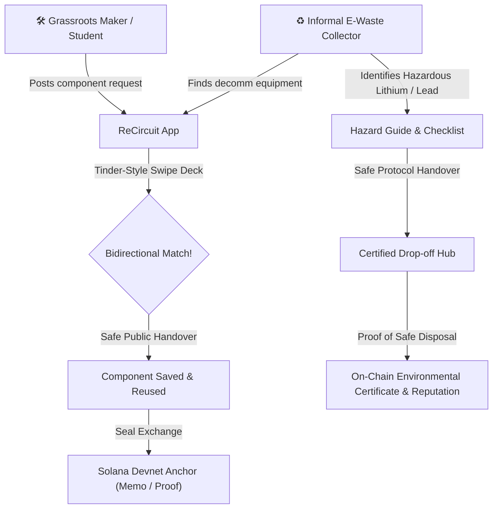

# ReCircuit — Swipe to Salvage E-Waste & Prove Safe Disposal

> **The Decentralized Circular Electronics Marketplace on Solana.**  
> Match salvageable e-waste parts directly with grassroots makers, and provide certified, safe disposal pathways for hazardous components (batteries, CRT, mercury) with verifiable proofs on Solana Devnet.

[](https://explorer.solana.com/?cluster=devnet)
[](LICENSE)
[](https://colosseum.com/worldsfair?ref=brasil)
[](https://superteam.fun/earn/listing/side-track-superteam-brasil)

---

## ⚡ The Urgent Problem

1. **62 Million Metric Tons of E-Waste** are generated globally every year. In developing nations like Brazil, less than **2.1%** is officially collected, while **97.9%** is either incinerated, landfilled, or shredded purely for scrap copper value.
2. **Grassroots Builders & Public Schools are Starved for Hardware:** Millions of students, self-taught makers, robotics clubs, and underprivileged families cannot afford new components. Meanwhile, millions of perfectly functional LGA1155 motherboards, DDR3 RAM sticks, 450W power supplies, and GPU cards are trashed from office decommissions every month.
3. **The Hidden Hazard Crisis (Laws Exist, Reality Fails):** Brazil has strict Reverse Logistics laws (Federal Law 12,305/2010 and Decree 10,240/2020), but informal waste collectors (*catadores*) receive **zero actionable guidance or financial incentives** for safely routing toxic hazards:
   - **Lithium-Ion / 18650 cells:** Burn in carts or contaminate groundwater when crushed.
   - **Lead-Acid UPS batteries:** Dumped on bare soil.
   - **CCFL lamps & CRT tubes:** Release airborne mercury and heavy lead dust when smashed.

---

## 💡 The Solution: ReCircuit

ReCircuit is the **"Tinder for Salvaged Electronics"** powered by Solana micro-transactions and immutable cryptographic receipts:



### 1. Tinder-Style Discovery Deck
* **Dual Roles:**
  - **Makers:** Swipe right on salvaged parts listed by nearby collectors (RAM, CPUs, GPUs, displays, fans, Arduino clones).
  - **Collectors:** Swipe right on makers' specific project requests (e.g., *"Need 10 DDR3 sticks for a public school lab in Recife"*).
* **Instant Match Modal:** Flags toxic components immediately before pickup is arranged.

### 2. Hazard Guide & Verifiable Safe Disposal
* Comprehensive visual handling protocols for **Lithium-Ion (18650)**, **Lead-Acid**, **CRTs**, **High-Voltage Capacitors**, **Mercury CCFLs**, and **Brominated Plastics**.
* Mandatory 3-step safety checklist before generating a disposal receipt.
* Calculates verified avoided toxicity scores and reputation points.

### 3. Solana Devnet Proofs
* Cryptographic hashes of exchange and disposal receipts are anchored on Solana using the **Memo Program** (`MemoSq4gqABAXKb96qnH8TysNcWxMyWCqXgDLGmfcHr`).
* In-browser Devnet burner wallet or **Phantom Wallet** integration.
* Zero barrier to entry: 1-click test with pre-funded Devnet faucet integration.

---

## 🛠️ System Architecture

```
[ Frontend: Vanilla HTML5 / Modern CSS Glassmorphism / JavaScript ES6+ ]
                          │
         ┌────────────────┴────────────────┐
         ▼                                 ▼
[ Local Storage + Geo-Match ]    [ Solana Web3.js SDK v1.95 ]
         │                                 │
         │                         ┌───────┴───────┐
         ▼                         ▼               ▼
[ Safe Handling Knowledge Base ] [ Phantom ] [ Devnet Demo Keypair ]
                                           │
                                           ▼
                       [ Solana Devnet: Memo Program ]
                       [ Hash / Payload Anchor / TX Sig ]
```

---

## 🚀 Quick Start (Run in 30 Seconds)

No complicated build tools or NPM dependencies required:

```bash
# Clone the repository
git clone https://github.com/luscaalvespereira/ReCircuit.git
cd ReCircuit

# Run any lightweight static server
npx http-server -p 8080
# Or: python -m http.server 8080

# Open in your browser
https://temporary-rushing-jasper-ip6tuk6.vercel.app
```

---

## 🧪 Judge Walkthrough (60-Second Test)

1. Open `https://temporary-rushing-jasper-ip6tuk6.vercel.app` (or the live demo link).
2. On the **Discover** tab, swipe right on the **DDR3 SO-DIMM RAM** or **GTX 750 Ti GPU** by clicking the green heart or dragging the card to the right.
3. In the **"It's a Match!"** dialog, click **View Match**.
4. Click **Connect Wallet** in the top bar and select **Demo Wallet (Devnet)**. A temporary keypair is generated and displayed instantly.
5. In the **Matches** tab, click **Seal Exchange ⛓**. A cryptographic transaction is sent to Solana Devnet and verified on Solana Explorer.
6. Switch to the **Safe Disposal** tab, choose **Lithium-ion batteries**, complete the 3 safety checkboxes, and click **Generate Receipt**.
7. Anchor the receipt on Solana and inspect the immutable hash!

---

## 🌿 Regulatory & Day-2 Sustainability

* **Compliance:** Aligns with Brazil's **National Solid Waste Policy (PNRS - Law 12,305/2010)** and **Decree 10,240/2020** for Reverse Logistics of Electronics.
* **Economic Model:**
  - **Phase 1 (Hackathon MVP):** P2P free exchange and tipping via Solana Pay.
  - **Phase 2 (Day 2 Enterprise):** Corporate reverse-logistics compliance fees. Large hardware manufacturers (Dell, Positivo, Samsung) purchase on-chain proof certificates of e-waste redirection to fulfill their legal recycling quotas.
* **Hardware & IoT Roadmap:** Integrates low-cost handheld battery capacity testers built on Raspberry Pi Pico (RP2040) to automatically verify cell health before listing.

---

## 👥 Team
* **Lucas Alves Pereira** — Founder & Full-Stack / Legal Tech Engineer (Faculdade de Direito do Recife / UFPE · Specialization in Environmental Law, Data Systems & Autonomous AI).

---

## 📜 License
MIT License — Free and open-source for community reuse and global environmental benefit.
